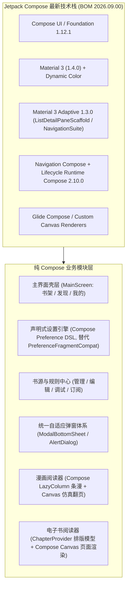

# 阅读 (Legado) 全量 Jetpack Compose 迁移计划（Zero UI XML）

## 1. 现状盘点与总体目标

经过孤儿文件清理后，当前项目中仍在使用、待迁移为 Jetpack Compose 的传统 Android UI XML 共计 **301 个文件**：

| 资源目录 | 剩余文件数 | 当前用途 | 迁移后目标状态 |
| :--- | :---: | :--- | :--- |
| `app/src/main/res/layout` | 216 | 34 个 `activity_*.xml`、10 个 `fragment_*.xml`、68 个 `dialog_*.xml`、67 个 `item_*.xml`、37 个 `view_*/popup_*/video_*` | **0 个文件（全部删除）** |
| `app/src/main/res/layout-land` | 3 | `activity_audio_play.xml`、`activity_book_info.xml`、`view_book_intro.xml` | **0 个文件（全部删除）** |
| `app/src/main/res/menu` | 71 | 顶栏 ActionBar 菜单、列表多选弹出菜单、上下文菜单 | **0 个文件（全部删除）** |
| `app/src/main/res/xml` (UI 设置) | 11 | `pref_main.xml`、`pref_config_*.xml` (9 个)、`about.xml` | **0 个文件（全部删除）** |
| `app/src/main/res/xml` (系统元数据) | 5 | `file_paths.xml`、`network_security_config.xml`、`backup_rules.xml`、`data_extraction_rules.xml`、`spen_remote_actions.xml` | **保留（Android OS 系统规范要求，非 UI 代码）** |

> [!IMPORTANT]
> **最终架构目标**：
> 1. **100% 纯 Jetpack Compose UI**：彻底移除 `res/layout*`、`res/menu` 与 `res/xml/pref_*.xml`，在 [`app/build.gradle.kts`](file:///Users/xiaobaitu/github.com/legado/app/build.gradle.kts) 中关闭 `viewBinding = true`。
> 2. **升级至最新版 Jetpack Compose 生态**：从当前 `compose-bom:2025.02.00` 升级至 Google Maven 最新稳定版 **`compose-bom:2026.09.00`**（Compose UI/Foundation `1.12.1`、Material 3 `1.4.0`、Material 3 Adaptive `1.3.0`）。
> 3. **原生响应式大屏架构**：使用官方 `androidx.compose.material3.adaptive` 的 `ListDetailPaneScaffold` 与 `WindowSizeClass`，从根源上杜绝传统 View + `FragmentTransaction` + `RecyclerView` 异步测量造成的平板横竖屏挤压、留白错位与控件裁切问题。

---

## 2. 目标技术栈与架构设计

### 2.1 依赖升级与裁剪清单（[`gradle/libs.versions.toml`](file:///Users/xiaobaitu/github.com/legado/gradle/libs.versions.toml)）
- **新增 / 升级依赖**：
  - `composeBom = "2026.09.00"`
  - `androidx.compose.material3.adaptive:adaptive`、`adaptive-layout`、`adaptive-navigation` (`1.3.0`)
  - `androidx.compose.material3:material3-adaptive-navigation-suite` (`1.4.0`)
  - `androidx.lifecycle:lifecycle-runtime-compose`、`androidx.lifecycle:lifecycle-viewmodel-compose` (`2.10.0`)
  - `androidx.navigation:navigation-compose`
- **迁移完成后移除的历史遗留 UI 依赖**：
  - `androidx.preference:preference` / `preference-ktx` 及项目中整个 `io.legado.app.lib.prefs.*` 包
  - `androidx.recyclerview:recyclerview`、`androidx.viewpager2:viewpager2`、`androidx.constraintlayout:constraintlayout`、`androidx.swiperefreshlayout:swiperefreshlayout`、`com.google.android.flexbox:flexbox`、`com.jaredrummler:colorpicker`
  - 项目中 `io.legado.app.ui.widget.recycler.*` 与 `io.legado.app.base.adapter.*` 全部旧版 Adapter 基类

### 2.2 第三方原生 SDK 视图的 Compose 桥接策略
对于极少数底层基于 Surface / OpenGL / 自绘编辑器的第三方组件，采用 Compose 官方 `AndroidView` 组件内联封装（不再需要任何 `.xml` 布局文件）：
1. **代码编辑器（`SoraEditor`）**：通过 `AndroidView(factory = { CodeEditor(it) })` 嵌入，外围工具栏、快捷符号栏、搜索框全部使用 Compose。
2. **网页容器（`WebView`）**：通过 `AndroidView(factory = { WebView(it) })` 嵌入，顶部进度条、地址栏与菜单全部使用 Compose。
3. **视频解码画面（`ExoPlayer` / `GSYVideoPlayer`）**：通过 `AndroidView` 承载视频纹理层，播放控制面板、选集抽屉、倍速选择器、悬浮窗控件全部改为 Compose 覆盖层。
4. **相机扫码（`ZXing` PreviewView）**：通过 `AndroidView` 承载相机预览流，取景框动画与底部操作栏改为 Compose。

---

## 3. 分阶段实施路线图（共 6 个阶段）

为保证每一步都可编译、可测试、可独立验收，按模块耦合度由低到高分为 **Phase 0 ~ Phase 6** 推进，**每完成一个模块立即物理删除对应的 `.xml` 文件**。

### Phase 0：升级 Compose 2026.09 基座与通用 UI 组件库
- 升级 `composeBom = "2026.09.00"`，引入 Material 3 Adaptive (`1.3.0`) 与 Lifecycle Compose (`2.10.0`)。
- 构建 `io.legado.app.ui.compose.component` 通用组件库（`LegadoTopAppBar`、`LegadoSearchBar`、`LegadoOverflowMenu`、`LegadoSelectActionBar`、`LegadoBookCover`、`LegadoEmptyErrorView`、`LegadoAdaptiveDialog`），一次性替代 35+ 个通用 `view_*.xml` / `popup_*.xml` 与全部 71 个 `res/menu/*.xml` 菜单模式。

### Phase 1：设置中心与「我的」全模块 Compose 化（彻底废弃 `PreferenceFragmentCompat`）
- 构建纯 Compose 声明式设置组件库（`io.legado.app.ui.compose.prefs`），替代全部 11 个 `res/xml/pref_*.xml` + `about.xml`。
- 使用 `ListDetailPaneScaffold` 重写 `MyScreen` 与 10 个子配置页（备份、主题、其他、阅读、朗读、封面、欢迎页、关于），以及阅读记录、全部书签、替换净化、字典规则、TXT 目录规则、高亮规则、文件管理。

### Phase 2：主界面壳层、书架、发现、搜索与书籍详情 Compose 化
- `MainActivity` 转为纯 `setContent` 承载 `BookshelfScreen`、`ExploreScreen`、`MyScreen`。
- 重写书架（样式 1 / 样式 2、整理书架、本地导入、缓存导出）、发现页（`ListDetailPaneScaffold` 双栏分类 + 列表）、全局搜索、书籍详情（横竖屏自适应单/双栏）及目录页。

### Phase 3：书源生态、规则订阅、调试、登录与代码编辑器 Compose 化
- 重写书源管理（支持拖拽排序与批量操作）、书源编辑、JS 扩展编辑、书源调试、规则订阅、书源登录、WebView 浏览器、二维码扫描与代码编辑器外围界面。

### Phase 4：全量业务弹窗与通用对话框 Compose 化
- 将剩余全部 `dialog_*.xml`（换源、换封面、分组选择、词典、日志、WebDAV、文件选择器、更新弹窗等）重构为 Compose `ModalBottomSheet` / `AlertDialog`。

### Phase 5：音视频播放器、TTS 朗读与漫画阅读器 Compose 化
- 重写 `AudioPlayActivity`、`VideoPlayerActivity`（`AndroidView` 仅包裹底层解码视图，控制器全部 Compose 化）。
- 重写 `ReadMangaActivity`：菜单与设置弹窗全部 Compose 化；条漫使用 `LazyColumn` + 手势缩放，横屏双页/单页仿真翻页使用 Compose `Canvas` 复用 `MangaPageCurlRenderer` 与边缘取色算法。

### Phase 6：文字电子书阅读器 (`ReadBookActivity`) Compose 化与收官清理
- 迁移阅读器上下菜单、朗读悬浮条、长按选词气泡、正文搜索及全部阅读设置底部面板为 Compose。
- 保留 `ChapterProvider` / `TextChapterLayout` 核心排版算法（产出 `TextPage` 数据模型），使用 Compose `Canvas` 替代 `view_book_page.xml` 与 `activity_book_read.xml`。
- 删除 `res/layout*`、`res/menu`、`res/xml/pref_*.xml` 全部残留文件，在 `app/build.gradle.kts` 中移除 `viewBinding = true` 与旧版 View 依赖库。
