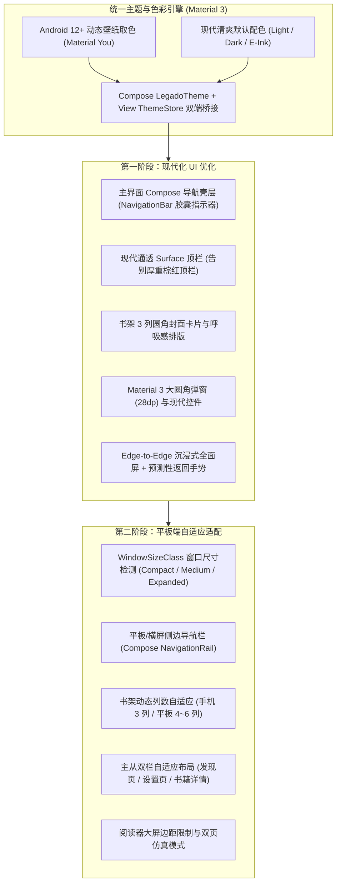

# 阅读 (Legado 3.0+) UI 现代化与平板端适配方案

## 1. 背景与目标

基于 `v3.0.0` 精简基线版本，对应用进行分阶段 UI 架构升级：
- **第一阶段（现代化 UI 优化）**：引入 Android 官方最新推荐的 **Jetpack Compose + Material 3 (Material You)** 架构，重塑色彩体系、导航壳层、卡片与弹窗视觉，全面启用 Android 12~15+ 现代系统特性（动态壁纸取色、Edge-to-Edge 全面屏、预测性返回手势），并彻底清理历史遗留的复杂主题折腾项。
- **第二阶段（平板端与大屏适配）**：基于 Compose Adaptive（`WindowSizeClass` / `NavigationRail` / 双栏主从结构）与大屏响应式网格，实现手机、折叠屏、平板（横竖屏）与多窗口分屏下的原生自适应体验。

---

## 2. 总体技术架构

---

## 3. 第一阶段：现代化 UI 优化（实施细则）

### 3.1 引入 Jetpack Compose + Material 3 基础构建
- **构建配置**：
  - [`gradle/libs.versions.toml`](file:///Users/xiaobaitu/github.com/legado/gradle/libs.versions.toml)：引入 `kotlin-compose` 编译器插件（跟随 Kotlin 版本）、`androidx.compose:compose-bom`、`androidx.compose.material3:material3`、`androidx.compose.ui:ui`、`androidx.compose.material:material-icons-extended`。
  - [`build.gradle`](file:///Users/xiaobaitu/github.com/legado/build.gradle) 与 [`app/build.gradle`](file:///Users/xiaobaitu/github.com/legado/app/build.gradle)：启用 `alias(libs.plugins.kotlin.compose)` 与 `buildFeatures { compose = true }`。
- **混合演进边界**：
  - 主界面导航栏及新增现代组件采用 Jetpack Compose (`ComposeView`) 编写。
  - 阅读器核心排版画布（[`ReadView.kt`](file:///Users/xiaobaitu/github.com/legado/app/src/main/java/io/legado/app/ui/book/read/page/ReadView.kt)）与成熟业务列表保持高性能复用，通过统一的 M3 色彩 Token 同步视觉风格。

### 3.2 色彩体系重塑与 Android 新特性接入
- **Material You 动态取色默认启用**：
  - 在 Android 12+ (`API >= 31`) 设备上，[`PreferKey.wallpaperColorFollow`](file:///Users/xiaobaitu/github.com/legado/app/src/main/java/io/legado/app/constant/PreferKey.kt) 默认开启，自动从系统壁纸提取种子色生成 Material 3 日间/夜间调色板（[`WallpaperTheme.kt`](file:///Users/xiaobaitu/github.com/legado/app/src/main/java/io/legado/app/lib/theme/WallpaperTheme.kt)）。
- **现代默认浅色/深色主题（替代旧版棕红配色）**：
  - **浅色模式（Light）**：
    - 背景色（Background / Surface）：`#F8F9FA`（通透清爽浅灰白）
    - 顶栏/底栏容器色（Surface Container）：`#F1F3F5`（与背景自然过渡，取消旧版 `#795548` 深棕色块）
    - 主色调 / 强调色（Primary / Accent）：`#3B5BA9`（现代深海蓝）
  - **深色模式（Dark）**：
    - 背景色（Background / Surface）：`#121316`（柔和暗夜黑）
    - 顶栏/底栏容器色（Surface Container）：`#1A1C20`
    - 主色调 / 强调色（Primary / Accent）：`#8FB0FF`（柔和亮蓝）
  - **墨水屏模式（E-Ink）**：保持纯白底纯黑字高对比度无动画模式。
- **全面屏（Edge-to-Edge）与预测性返回手势（Predictive Back）**：
  - 状态栏与底部手势导航栏默认全透明沉浸（[`BaseActivity.kt`](file:///Users/xiaobaitu/github.com/legado/app/src/main/java/io/legado/app/base/BaseActivity.kt)），根据当前 Surface 亮度自动切换状态栏/导航栏图标深浅。
  - 默认启用 Android 13/14+ 预测性返回手势动画（`android:enableOnBackInvokedCallback="true"`）。

### 3.3 精简冗余主题配置（删除历史包袱）
- **清理模块清单**：
  - 删除底栏皮肤图集系统：[`BottomBarSkinManager.kt`](file:///Users/xiaobaitu/github.com/legado/app/src/main/java/io/legado/app/help/BottomBarSkinManager.kt)、[`BottomBarSkinActivity.kt`](file:///Users/xiaobaitu/github.com/legado/app/src/main/java/io/legado/app/ui/config/BottomBarSkinActivity.kt)、[`BottomBarSkinAssignActivity.kt`](file:///Users/xiaobaitu/github.com/legado/app/src/main/java/io/legado/app/ui/config/BottomBarSkinAssignActivity.kt)、[`BottomBarSkinAssignViewModel.kt`](file:///Users/xiaobaitu/github.com/legado/app/src/main/java/io/legado/app/ui/config/BottomBarSkinAssignViewModel.kt) 及对应布局文件与单元测试。
  - 删除预设主题列表与手动调色盘：[`ThemeListDialog.kt`](file:///Users/xiaobaitu/github.com/legado/app/src/main/java/io/legado/app/ui/config/ThemeListDialog.kt)、[`defaultData/themeConfig.json`](file:///Users/xiaobaitu/github.com/legado/app/src/main/assets/defaultData/themeConfig.json)、手动颜色选择器（`colorPrimary` / `colorAccent` / `colorBackground` / `colorBottomBackground`）及背景图片/高斯模糊设置。
- **精简后的「主题设置」页面**（[`pref_config_theme.xml`](file:///Users/xiaobaitu/github.com/legado/app/src/main/res/xml/pref_config_theme.xml)、[`ThemeConfigFragment.kt`](file:///Users/xiaobaitu/github.com/legado/app/src/main/java/io/legado/app/ui/config/ThemeConfigFragment.kt)）：
  - 仅保留核心实用项：
    1. **跟随壁纸动态取色**（Android 12+ 默认开启）
    2. **壁纸变更自动更新配色**
    3. **桌面图标切换**
    4. **封面样式配置**
    5. **全局字体缩放**
    6. **状态栏 / 导航栏沉浸与预测性返回开关**
- **数据兼容与异常回退**：
  - 旧版备份或本地残留的自定义颜色、背景图配置在读取时忽略并自动使用新的现代默认主题色，确保升级与恢复备份零报错。

### 3.4 主界面、书架与弹窗组件视觉升级
- **主界面底部导航栏（Compose M3 `NavigationBar`）**：
  - 在 [`MainActivity.kt`](file:///Users/xiaobaitu/github.com/legado/app/src/main/java/io/legado/app/ui/main/MainActivity.kt) 与 [`activity_main.xml`](file:///Users/xiaobaitu/github.com/legado/app/src/main/res/layout/activity_main.xml) 中使用 Compose `NavigationBar` + `NavigationBarItem` 替代旧版无标签 `ThemeBottomNavigationVIew`。
  - 具备 Material 3 标准 **胶囊选中指示器（Active Indicator Pill）**、图标 + 文字标签（「书架」「发现」「我的」）、未读更新角标（`Badge`）及双击返回顶部/折叠交互。
- **书架与封面卡片升级**：
  - [`CoverImageView.kt`](file:///Users/xiaobaitu/github.com/legado/app/src/main/java/io/legado/app/ui/widget/image/CoverImageView.kt)：封面圆角由 `4dp` 提升至现代 `8dp` 圆角，柔和描边与阴影。
  - [`item_bookshelf_grid.xml`](file:///Users/xiaobaitu/github.com/legado/app/src/main/res/layout/item_bookshelf_grid.xml) & [`item_bookshelf_list.xml`](file:///Users/xiaobaitu/github.com/legado/app/src/main/res/layout/item_bookshelf_list.xml)：优化书名行高、字重、间距与阅读进度条圆角样式。
  - [`view_bookshelf_header.xml`](file:///Users/xiaobaitu/github.com/legado/app/src/main/res/layout/view_bookshelf_header.xml)：升级「继续阅读」顶部横幅为现代圆角 Surface 卡片。
- **对话框与下拉控件升级**：
  - [`AndroidDialogs.kt`](file:///Users/xiaobaitu/github.com/legado/app/src/main/java/io/legado/app/lib/dialogs/AndroidDialogs.kt) 与 [`styles.xml`](file:///Users/xiaobaitu/github.com/legado/app/src/main/res/values/styles.xml)：统一圆角弹窗背景（`24dp`~`28dp` 圆角），移除过时的 `android:Theme.Holo.Light` Spinner 样式。

---

## 4. 第二阶段：平板端与大屏适配（实施细则）

在第一阶段完成后推进，重点解决平板横竖屏、折叠屏展开态及分屏模式下的空间利用与交互体验：

1. **自适应导航框架（`NavigationBar` ↔ `NavigationRail`）**：
   - 基于窗口宽度（`sw600dp` / `WindowSizeClass. EXPANDED` & `MEDIUM`），在手机竖屏展示底部 `NavigationBar`，在平板或大屏横屏自动切换为左侧垂直 **`NavigationRail`**，释放纵向阅读与浏览空间。
2. **书架网格动态列数自适应**：
   - 根据容器可用宽度自动计算网格列数（或提供平板端默认 5 列/自适应列宽），避免 3 列封面在平板上被过度放大。
3. **关键页面双栏主从布局（List-Detail Two-Pane）**：
   - **「我的 / 设置」与「发现」页面**：平板端采用左栏导航列表 + 右栏详情内容区的双栏并行结构，告别大屏单列长条拉伸。
   - **弹窗与底部面板宽度约束**：在大屏设备上限制对话框与底部面板最大宽度（`maxWidth = 560dp`），避免横向铺满全屏。
4. **大屏阅读器体验优化**：
   - 优化平板横屏下的正文最大行宽/页边距，支持大屏双页并排阅读模式（Two-Page Spread）。

---

## 5. 验证与回滚标准

- **回滚方案**：每个阶段独立提交，第一阶段实施前基线为 `cf73a197d`，可随时通过 `git reset --hard cf73a197d` 无损回退。
- **第一阶段验收标准**：
  1. `./gradlew testAppDebugUnitTest` 全部单元测试通过。
  2. `./gradlew assembleAppRelease` R8 混淆与资源压缩打包通过。
  3. 模拟器实测验证：
     - 顶栏、背景、状态栏呈现现代通透的 Material 3 浅色/深色/动态壁纸配色（无旧版棕红顶栏）。
     - 底部导航栏具备 M3 胶囊指示器与清晰图标文字标签，支持角标与双击回到顶部。
     - 书架 3 列圆角封面、圆角弹窗及精简后的主题设置页交互正常，Logcat 零崩溃。

